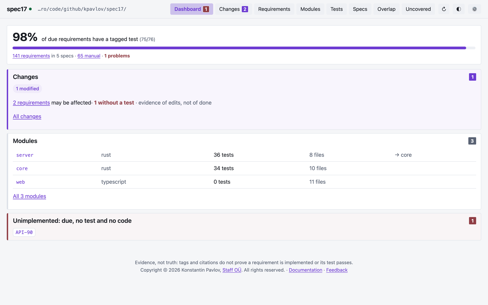
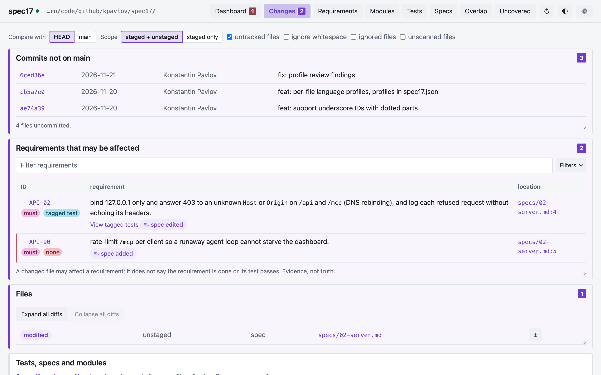

# spec17

https://spec17.dev

Deterministic spec-driven-development evidence for a repo: which requirement IDs in `specs/*.md` have tests, code citations, spec problems, or overlap with other requirements. No LLM in the core.

> **Evidence, not truth.** A citation or test tag does not prove a requirement is implemented or that its test passes. Output is a candidate list for a human or an assessor to judge.

One Rust binary gives three interfaces over the same core: a CLI, an MCP server (streamable HTTP or stdio) and a web dashboard.

<picture>
  <source media="(prefers-color-scheme: dark)" srcset="docs/static/img/dashboard-dark.png">
  
</picture>

## Quickstart

Add the Homebrew tap and install the prebuilt development version on Apple Silicon.

```sh
brew tap kpavlov/spec17 https://github.com/kpavlov/spec17
brew install kpavlov/spec17/spec17-dev
```

For a tagged release, use `brew install kpavlov/spec17/spec17`.

From the project you want to scan, run `spec17 report` for a terminal summary or `spec17` to open the dashboard.

```sh
cd /path/to/your/repo
spec17 report
spec17
```

To connect an agent, run `spec17 install` (repo skill + HTTP entry in `.mcp.json`) and keep `spec17` running.



## Documentation

- [Quickstart](https://spec17.dev/quickstart/): install, scan, a three-file example.
- [Usage](https://spec17.dev/usage/): every command, the dashboard and its URLs, CodeGraph, doctor.
- [Specs and tests](https://spec17.dev/specs/): requirement styles, test tags, citations, states, `spec17.json`.
- [Agents](https://spec17.dev/agents/): the skill, HTTP and stdio MCP clients, tools and resources.

## Develop

Needs Rust (stable), Node and pnpm (pinned by `packageManager` in `web/package.json`). The release build embeds the web UI; the binary needs none of the three at runtime. `ROOT` defaults to this repo: spec17 scans itself (see `specs/` and `spec17.json`).

```sh
make dev                      # Vite HMR + Rust server on :7411, opens the browser
make run                      # release binary with the UI embedded, serves on :7411
make build                    # target/release/spec17
make install                  # cargo install into ~/.cargo/bin (make uninstall to remove)
make report                   # text report
make test                     # cargo tests
make parity                   # Rust output == the old Python scripts' output (needs them vendored in ROOT)
make bench                    # time the scan at main vs HEAD (see Benchmark)
make docs                     # build the Hugo site in docs/ into docs/public (Hugo >= 0.146)
make site                     # Hugo dev server with live reload on :1313
make dev ROOT=/path/to/repo PORT=7500 OPEN=0
```

Without `make`:

```sh
(cd web && pnpm install --frozen-lockfile && pnpm run build)
SKIP_WEB_BUILD=1 cargo install --path server --locked   # or: cargo build --release, then target/release/spec17
```

`SKIP_WEB_BUILD=1` skips the UI build that `build.rs` runs for release builds, once `web/dist` exists. In debug builds the server proxies the UI to Vite (`localhost:5173`).

```
core/     spec17-core: scan, config, report, coverage, codegraph (the only SQL)
server/   spec17 binary: CLI, axum API, MCP (rmcp), UI serving
web/      Svelte 5 + Vite (no SvelteKit), builds to one dist/index.html
skills/   the agent skill (SKILL.md), embedded in the binary
docs/     Hugo site for spec17.dev (make docs); .github/workflows/pages.yml publishes it to GitHub Pages
bench/    bench.py: before/after timings (make bench)
```

## Releases

For a tagged release, start from a clean checkout with the version set in `Cargo.toml`. Push the tag and dispatch the Linux x86_64, Linux ARM64, and Windows x86_64 builds:

```sh
git tag v0.1.0
git push origin v0.1.0
gh workflow run prerelease.yml -f tag=v0.1.0
```

On a Mac, build, sign, and upload its native archive to the same prerelease. The Mac and CI uploads can happen in either order.

```sh
git checkout v0.1.0
make upload TAG=v0.1.0
```

Once all uploads finish, dispatch tap generation. It verifies the Linux and Windows assets and at least one Mac archive against their uploaded checksums, then pushes `Formula/spec17.rb` to the default branch. Rerun it if you replace an archive. After the tap run succeeds, promote the release by hand:

```sh
gh workflow run tap.yml -f tag=v0.1.0
# Wait for the tap workflow to succeed before promoting.
gh release edit v0.1.0 --prerelease=false --latest
```

Archives are named `spec17-<version>-<os>-<arch>.tar.gz` (`.zip` on Windows), each with a `.sha256` file. Use `make dist` to package locally. The Mac build signs ad hoc by default. Set `SIGN_IDENTITY` on `make upload` or `make dist` to use another signing identity. Run the upload on each Mac architecture you want to ship. Uploads require an authenticated `gh`, and tap generation requires permission for the workflow token to push to the default branch.

### Dev releases

On an Apple Silicon Mac, run this from a clean `main` matching `origin/main`.

```sh
make release-dev
```

The command builds and signs a timestamped archive, uploads it with its checksum to the rolling prerelease, and writes `Formula/spec17-dev.rb`. Commit and push that file to publish the Homebrew update. Users get the new binary with `brew update && brew upgrade spec17-dev`. [Rolling prerelease](https://github.com/kpavlov/spec17/releases/tag/edge)

`spec17 --version` and the dashboard's Setup screen show the dev build's commit and UTC build time, for example `0.1.0-dev+a91c8e8b23c4 (2026-11-20T18:08:16Z)`.

Homebrew's standard HEAD option still builds the default branch locally.

```sh
brew install --HEAD kpavlov/spec17/spec17
```

If the repository is private, set `HOMEBREW_GITHUB_API_TOKEN` to a token with repository read access for prebuilt downloads.

## Benchmark

`make bench` times the CLI on a generated repo at several git revisions, so a change can be compared with a baseline. Each command is a full load (`Analysis::load`), so the numbers are mostly scan time.

```sh
make bench                                      # main vs HEAD, scale 1, 10 runs
make bench REVS="main HEAD ." SCALE=4 RUNS=20   # `.` is the working tree, uncommitted changes included
make bench JSON=1                               # one JSON document instead of a Markdown table (for scripts and agents)
python3 bench/bench.py --help
```

- The repo is generated deterministically under `target/bench/repo-<scale>`: bullet specs only (so old and new revisions read it the same way) with non-ASCII text, source files citing requirements, test files tagging them, and markdown docs; no CodeGraph index. Scale 1 is 2,000 requirements, 400 source files, 100 test files and 100 docs.
- Each revision is built once (release, no web UI) and cached in `target/bench/bin`; `.` is rebuilt every run. Revisions are exported with `git archive`, so nothing is written to `.git`.
- The first revision listed is the baseline. The table has median, min and stdev in ms, the change of the median against the baseline, and a hash of each command's output; the run says whether the output is the same for every revision. A speed-up must not change the output.
- Stdlib Python only.

Results (scale 4: 8,000 requirements, 1,600 source files, 400 test files, 400 docs; median of 10 runs; one macOS machine, so compare the ratios, not the milliseconds):

| command | `main` | `e1755f6` (new spec formats) | `HEAD` (+ scan speed-ups) |
|---|--:|--:|--:|
| `report` | 98 ms | 167 ms (+70%) | 113 ms (+15%) |
| `status --all` | 125 ms | 180 ms (+44%) | 139 ms (+11%) |
| `trace GEN-0001` | 102 ms | 160 ms (+57%) | 117 ms (+15%) |

The output of every command is byte-identical across the three revisions. Supporting the new spec formats (heading and paragraph blocks, dotted IDs, OpenSpec deltas, UTF-8 cleaning) cost 44–70%; the speed-ups (one walk per folder, ASCII word boundaries, one pass for struck and removed IDs, slices instead of copies) won back about two thirds of it, and the scan is still 11–15% slower than before. The 1-second change poll behind `resources/updated` is not covered: the CLI does not expose it.
